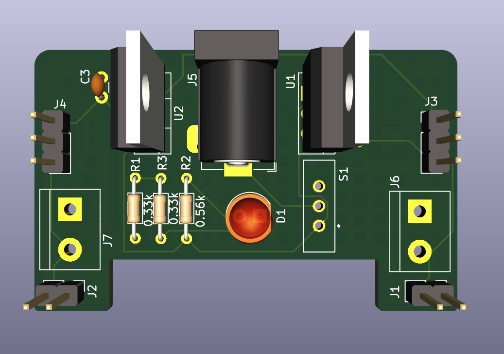
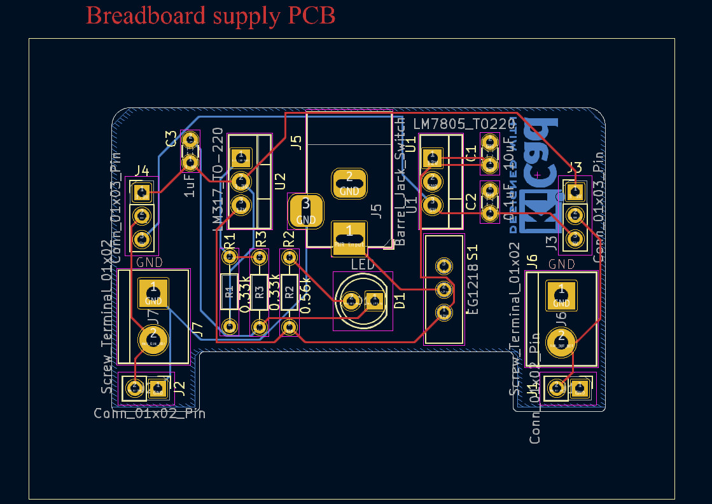
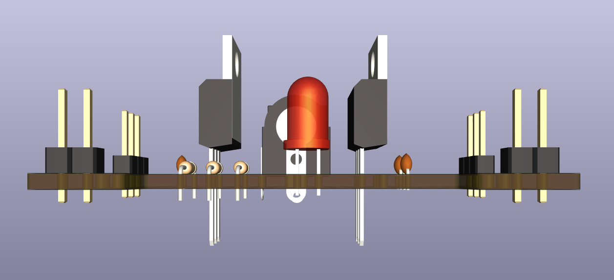
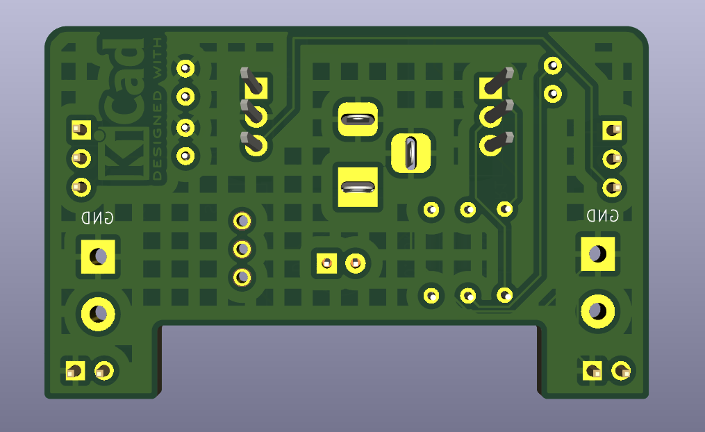

# Breadboard Power Supply Module — Custom PCB

A through-hole KiCad design for a breadboard power supply: a DC barrel-jack input, an LM7805 5 V stage, an LM317 stage intended for 3.3 V, and 2.54 mm headers and screw terminals that bring power to a solderless breadboard's rails.

> **Status: design in review — not validated, not fabricated, not tested.** The design files have not been through ERC/DRC, and reading the schematic shows the LM317 (3.3 V) stage's ADJ pin has no connection to ground, so the 3.3 V output is not set as intended. See [Known issues](#known-issues-and-validation-status) before ordering or building anything.



## Contents

- [Intended use](#intended-use)
- [Gallery](#gallery)
- [What the design files confirm](#what-the-design-files-confirm)
- [Block-level description](#block-level-description)
- [Specifications](#specifications)
- [Major components](#major-components)
- [Tools and opening the project](#tools-and-opening-the-project)
- [Known issues and validation status](#known-issues-and-validation-status)
- [Documentation](#documentation)
- [Contributing, licence, attribution](#contributing-licence-attribution)

## Intended use

Prototyping with breadboards usually needs 5 V and/or 3.3 V from a bench or wall DC supply. This board takes a DC input at a barrel jack, regulates it linearly and presents the rails on headers sized to plug into breadboard power rails. Intended for low-power, low-voltage hobby/lab use only.

## Gallery

| | |
|---|---|
|  |  |
| KiCad PCB editor, 2D view: routing on F.Cu (red) and B.Cu (blue) and the board outline with its bottom notch. | KiCad 3D viewer, top: TO-220 regulators, barrel jack, LED, slide switch, headers and terminals. |
|  |  |
| 3D side view: header pin lengths and component heights. | 3D bottom view: hatched GND copper zone and solder side. |

These are KiCad renders, **not photographs of a built board**. They also pre-date the current design files: the 2D view labels R2 as 0.56k and R3 as 0.33k, while `PCB_01.kicad_sch`/`.kicad_pcb` set R2 = 0.33k and R3 = 0.56k. No schematic screenshot exists in the repository.

## What the design files confirm

- Single DC input through barrel jack **J5**, then slide switch **S1**.
- **U1 LM7805** (TO-220) fixed regulator produces the `/5V` net.
- **U2 LM317** (TO-220) adjustable regulator produces the `/3.3V` net (net name only — see issues).
- Two breadboard-rail outputs, `PWR_OUT_TOP` and `PWR_OUT_BOT`. Each can be jumpered to 3.3 V or 5 V on a 3-pin header (J4 / J3) and is exposed on a 2-pin header and a screw terminal (J2/J7 and J1/J6).
- One LED (**D1**) with a series resistor, powered from the switched input net.
- Board outline 53.5 mm × 33.0 mm, two copper layers (F.Cu, B.Cu), 1.6 mm, hatched GND zone on B.Cu, no vias, all through-hole parts.

**Not present in the design:** USB input, AMS1117 regulators, a second LED, any fuse or reverse-polarity protection.

## Block-level description

```
J5 barrel jack -> S1 slide switch -> /12V net (net name only; voltage unspecified)
                                      |-> C1 -> U1 LM7805 -> /5V  (C2 to GND)
                                      |-> U2 LM317 -> /3.3V  (R1 OUT-ADJ, R3 -> D1 cathode net, C3)
                                      '-> R2 -> D1 LED -> R3 -> U2 ADJ
J3 / J4: pin1 3.3V, pin2 rail out, pin3 5V (jumper selects) -> J1+J6 (BOT) / J2+J7 (TOP)
```

Full detail, net list and issues: [docs/circuit-design.md](docs/circuit-design.md).

## Specifications

| Item | Value | Source / status |
|---|---|---|
| Input connector | DC barrel jack with switch contact (`BarrelJack_Horizontal`) | Confirmed (schematic) |
| Input voltage range | **Unspecified** | Design only names the net `/12V`; limits depend on datasheets (not verified here) |
| Input polarity | Pin 1 (tip) → switch; pin 2/3 (sleeve/switch) → GND; no protection | Confirmed; plug polarity must be checked |
| 5 V stage | LM7805 in TO-220 | Confirmed; nominal 5 V from part type, not measured |
| 3.3 V stage | LM317, R1 = 0.33k, R3 = 0.56k | **Defect as drawn**: ADJ has no path to GND; output not 3.3 V by design |
| Output current | **Unspecified / unverified** | Depends on dropout, input voltage, heat sinking; none computed |
| USB input | **None** | Earlier README claim removed |
| Board size | 53.5 mm × 33.0 mm (outline bounding box) | Confirmed (Edge.Cuts) |
| Layers / thickness | 2 / 1.6 mm | Confirmed |
| Track width | 0.2 mm on all segments | Confirmed |
| Design software | KiCad 8.0 (file format `generator_version 8.0`) | Confirmed from files |
| Efficiency, ripple, thermal, EMC | Not measured | Unknown |

## Major components

| Ref | Part | Role |
|---|---|---|
| J5 | Barrel jack with switch | DC input |
| S1 | EG1218 slide switch | Input on/off (pin 3 unused) |
| U1 | LM7805 (TO-220) | 5 V regulator |
| U2 | LM317 (TO-220) | Adjustable regulator for the 3.3 V rail |
| R1, R2 | 0.33k | LM317 OUT–ADJ; LED series |
| R3 | 0.56k | ADJ network |
| C1, C2, C3 | 10 µF, 0.1 µF, 1 µF | Decoupling (see issues) |
| D1 | 5 mm LED | Power indicator |
| J1–J4 | 2.54 mm headers | Rail outputs and 3.3 V/5 V selection |
| J6, J7 | 5.08 mm screw terminals | Rail outputs |

Full list: [docs/bill-of-materials.csv](docs/bill-of-materials.csv) (17 parts, no sourcing data in the design).

## Tools and opening the project

- **KiCad 8.0 or newer** (files were saved by KiCad 8.0; schematic format 20231120, PCB format 20240108). KiCad 7 cannot be assumed to open them; the old README's "KiCad 7" claim was not supported by the files.
- Open `PCB_01.kicad_pro`. Schematic: `PCB_01.kicad_sch`; board: `PCB_01.kicad_pcb`.
- BOM: Schematic Editor → *Tools → Generate Bill of Materials* (or `kicad-cli sch export bom`).
- Fabrication outputs: PCB Editor → *File → Fabrication Outputs* (Gerbers, drill). See [docs/fabrication-and-assembly.md](docs/fabrication-and-assembly.md).
- `sym-lib-table` references a Windows-only absolute path for the `EG1218` library; the symbol and footprint are embedded in the design files, so the project still loads, but KiCad may warn about that library.

## Known issues and validation status

| Check | Status |
|---|---|
| ERC | **Not run** (`kicad-cli` unavailable in the review environment) |
| DRC | **Not run** |
| Schematic ↔ PCB net comparison | Done by script for the reference/pad nets: consistent |
| Gerber review | Not done |
| Bench test | Not done; no evidence the board was ever built |

Open design concerns (details in [docs/circuit-design.md](docs/circuit-design.md)):

1. **LM317 ADJ not connected to GND.** R1 (OUT–ADJ) and R3 meet at ADJ, but R3's other end goes to the LED cathode net, not ground. No resistor to ground exists. The output voltage is therefore not defined by the intended divider.
2. **LED sits in the ADJ network** (12 V → R2 → D1 → R3 → ADJ) rather than being an indicator on a rail.
3. **C3 (1 µF)** connects /3.3V to the LED cathode net, not to GND. The 3.3 V rail has no capacitor to ground.
4. No reverse-polarity or over-voltage protection; no heatsinks; only 0.2 mm traces everywhere.
5. Capacitors use a ceramic disc footprint including the 10 µF part.

Do not fabricate or power this design before the owner reviews these. See [docs/validation-and-testing.md](docs/validation-and-testing.md) and [docs/safety-and-limitations.md](docs/safety-and-limitations.md).

## Documentation

[Project overview](docs/project-overview.md) · [Circuit design](docs/circuit-design.md) · [BOM](docs/bill-of-materials.csv) · [Fabrication & assembly](docs/fabrication-and-assembly.md) · [Validation & testing](docs/validation-and-testing.md) · [Safety & limitations](docs/safety-and-limitations.md) · [Roadmap](docs/roadmap.md) · [Licensing](docs/licensing.md) · [Changelog](CHANGELOG.md)

## Contributing, licence, attribution

See [CONTRIBUTING.md](CONTRIBUTING.md). **No licence file exists yet**, so all rights are reserved by default; see [docs/licensing.md](docs/licensing.md).

Design by [@yash-mehta13](https://github.com/yash-mehta13).

Suggested topics: `kicad` `pcb-design` `breadboard-power-supply` `lm317` `lm7805` `linear-regulator` `through-hole` `open-hardware`
